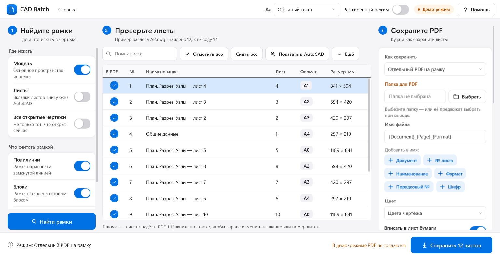
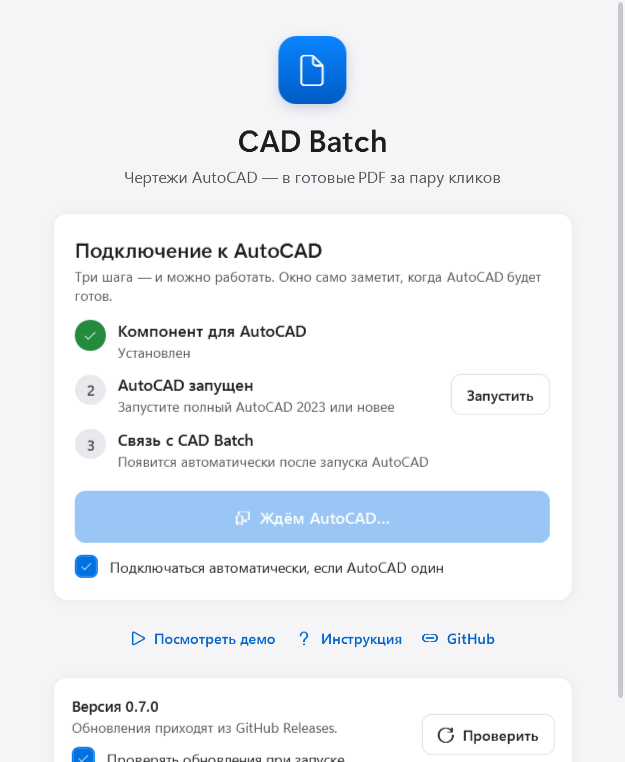
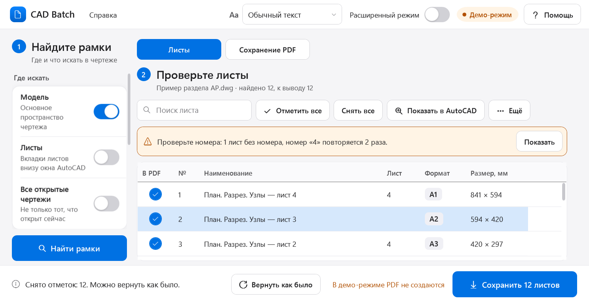
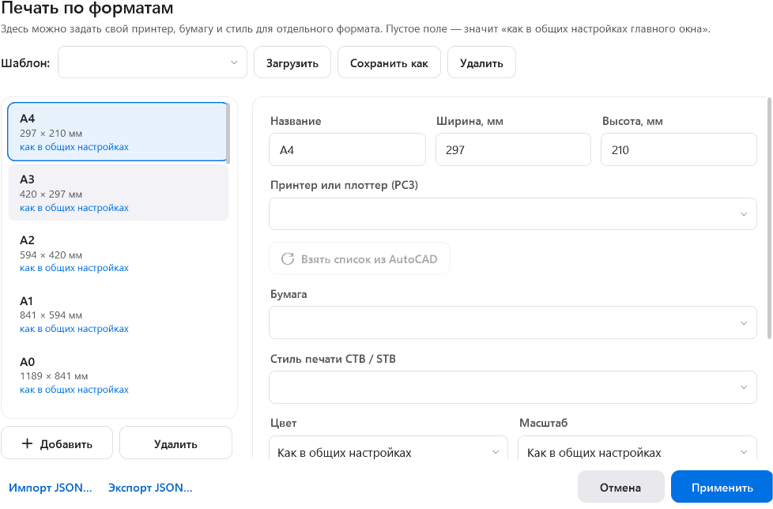
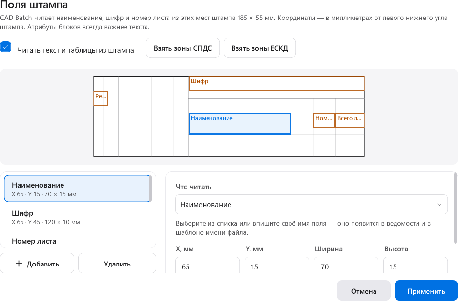

# CAD Batch

Приложение Windows, которое находит рамки листов в чертежах AutoCAD и выводит их в PDF — пачкой, в три шага.

[Скачать установщик](https://github.com/Geksod/CadBatch/releases/latest) · [Инструкция](docs/Start.md) · [Сообщить об ошибке](https://github.com/Geksod/CadBatch/issues/new/choose) · [История изменений](CHANGELOG.md)



## Как это работает

1. **Найдите рамки.** Слева выберите, где искать (модель, листы, все открытые чертежи), и нажмите «Найти рамки».
2. **Проверьте листы.** В списке видны все найденные листы. Галочка — лист попадёт в PDF. Название и номер можно исправить справа.
3. **Сохраните PDF.** Отдельные файлы, один общий PDF или группы по документам, форматам и шифрам. В конце — окно «Готово!» с кнопкой «Открыть папку».

Программа подсказывает следующий шаг, предупреждает о листах без номера и повторах, умеет вернуть случайно снятые отметки и повторить только незавершённые листы.

## Возможности

- Поиск рамок в модели и на листах, в блоках и внешних ссылках; 24 стандартных и кратных формата и свои размеры; масштаб по штампу.
- Поля штампа: наименование, шифр, номер листа, ревизия — из атрибутов, текста и таблиц.
- PDF: отдельные, общий или группами; цвет, бумага и плоттер для каждого формата; повтор листов по числу копий; замена файлов при перевыпуске.
- **ИУЛ по ГОСТ Р 21.101-2020** с контрольной суммой CRC32 — рядом с каждым PDF или для уже готовых файлов.
- Ведомость в Excel и CSV; исправленные в Excel названия и номера загружаются обратно.
- Листы Layout, экспорт DWG, упаковка с зависимостями, сохранённые комплекты и возобновление вывода.
- Простой режим для всех и расширенный — для опытных; три размера текста; режим высокой контрастности Windows.

| Подключение | Очень крупный текст |
|---|---|
|  |  |
| **Печать по форматам** | **Поля штампа** |
|  |  |

## Системные требования

- Windows 10 или 11, 64-разрядная.
- Полный AutoCAD 2023–2027. AutoCAD LT не поддерживается.
- AutoCAD 2021–2022 и отраслевые версии (Civil 3D, Architecture, Mechanical): компонент подготовлен, проверка на этих версиях ещё не проведена.
- Около 300 МБ на диске. Устанавливать .NET не нужно — среда входит в установщик. Права администратора не нужны.

## Установка

1. Сохраните работу и закройте AutoCAD.
2. Скачайте `CadBatch-Setup-<версия>.exe` из [Releases](https://github.com/Geksod/CadBatch/releases/latest) и запустите.
3. Откройте AutoCAD, затем CAD Batch — он сам найдёт AutoCAD. Нажмите «Подключиться».

Без AutoCAD интерфейс можно посмотреть кнопкой «Посмотреть демо» на начальном экране.

## Частые вопросы

**Нужен ли интернет?** Только для проверки обновлений. Чертежи и PDF обрабатываются на компьютере и никуда не отправляются.

**Как обновиться?** Приложение само сообщает о новой версии. Нажмите «Проверить» → «Скачать» → «Установить и перезапустить». Настройки и комплекты сохраняются, старая версия удаляется.

**Окно подключения пишет «Ждём AutoCAD…».** Запустите полный AutoCAD. Если он был открыт до установки CAD Batch — перезапустите его.

**AutoCAD пишет «Следующие комбинации, заданные для поиска плоттеров, признаны неверными».** Это настройка самого AutoCAD: в путях поиска плоттеров оказались ярлыки (.lnk). В AutoCAD откройте «Параметры → Файлы → Путь доступа к файлам поддержки принтеров» и удалите строки с ярлыками.

**Текст мелкий.** Вверху окна выберите «Крупный текст» или «Очень крупный текст».

**Что-то пошло не так.** Откройте «Справка → Собрать диагностику (ZIP)» и приложите файл к [сообщению об ошибке](https://github.com/Geksod/CadBatch/issues/new/choose). Чертежей в архиве нет.

**Где хранятся настройки?** В `%APPDATA%\CadBatch`; журнал ошибок — в `%LOCALAPPDATA%\CadBatch\logs`.

**Как удалить?** Параметры Windows → Приложения → CAD Batch → Удалить. Настройки и созданные PDF остаются.

## Лицензия

© 2026 Geksod. Все права защищены. Исходный код опубликован для ознакомления; официальные сборки можно бесплатно использовать до выхода платных версий. Условия — в [LICENSE](LICENSE). Сторонние компоненты: [THIRD-PARTY-NOTICES](packaging/THIRD-PARTY-NOTICES.txt).

## Разработка

Windows x64, .NET SDK 10, runtime .NET 8 для тестов.

```powershell
./scripts/build.ps1 -Restore
./scripts/package.ps1
```

`src/CadBatch.Core` — геометрия, задания, ведомости, ИУЛ; `Pdf` — PDF; `Transport` — локальный протокол; `AutoCAD` — компонент для AutoCAD; `Desktop` — приложение; `Updates` — обновления; `Setup` — установщик; `SharedUi` — окна.

Версия задаётся только в `Directory.Build.props`. Выпуск: [docs/Releasing.md](docs/Releasing.md). Проверка: [docs/Testing.md](docs/Testing.md). Безопасность: [SECURITY.md](SECURITY.md).
